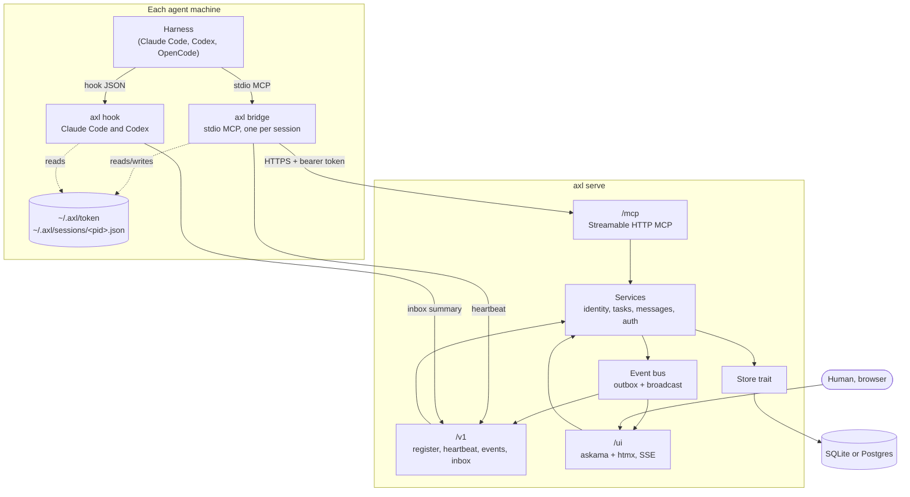
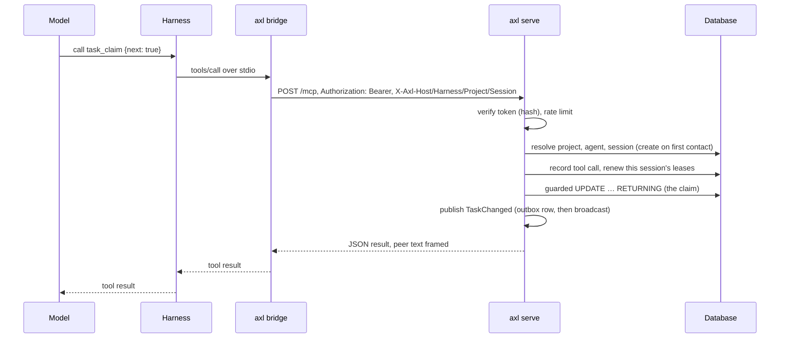

# Architecture

Axle is one Rust crate (`axle-mcp`) that builds one binary, `axl`. The same binary is the
server, the per-session stdio bridge, the Claude Code hook and the admin CLI.

## Components

| Component | Source | Role |
|---|---|---|
| CLI | `src/main.rs`, `src/cli/` | Subcommands `serve`, `bridge`, `hook`, `migrate`, `project`, `token`, and the onboarding set `install`, `uninstall`, `login`, `logout`, `status`, `service`. |
| HTTP server | `src/http/` | axum router: probes, `/v1`, `/mcp`, `/ui`; bearer-token middleware and rate limit. |
| MCP tools | `src/mcp/` | The 18 tools on rmcp, identity resolution per call, peer-data framing. |
| Services | `src/service/` | Business rules shared by MCP, `/v1` and the UI: identity, tasks and leases, messages, tokens. |
| Store | `src/store/` | A `Store` trait with `sqlite.rs` and `postgres.rs` implementations and migrations in `migrations/`. |
| Event bus | `src/events.rs` | Publishes changes after each commit. |
| Web UI | `src/ui/`, `templates/`, `static/` | Server-rendered pages and fragments, embedded in the binary. |
| Bridge | `src/bridge/` | Stdio MCP proxy, project detection, presence loop, session file. |
| Hook | `src/hook/` | Claude Code and Codex hooks; strictly fail-open. |
| Install | `src/install/`, `src/service/` (service units) | Edits each harness's config with backups and a manifest; writes the launchd or systemd unit. |
| Enrollment | `src/http/enroll.rs`, `src/http/install_script.rs`, `src/ui/connect.rs` | Unauthenticated `/v1/enroll` and `/v1/login/*` (per-IP limited), `GET /install.sh`, and the Connect a machine and `/ui/connect` pages. |

## A tool call, end to end

1. The bridge adds the token and the identity headers. The model supplies only the tool's
   arguments.
2. The server verifies the token against its stored hash and applies the per-token rate
   limit.
3. It resolves the caller's project, agent and session, creating them on first contact, and
   checks that the session belongs to the token.
4. The call counts as a heartbeat and renews the session's leases.
5. The service runs the operation. Every guarded change, such as a claim or a status
   transition, is a single statement or transaction whose `WHERE` clause is the rule, so a
   race has exactly one winner. The current time is computed in Rust and passed in, so both
   databases behave the same.
6. After the commit, the service publishes an event, and the result goes back with all peer
   text framed.

The bridge also runs a presence loop: `POST /v1/register` at start and
`POST /v1/heartbeat` every 30 seconds. If the server is unreachable it keeps serving the
tool list and answers calls with `axle unavailable: <reason>` while it retries.

## Stores

The `Store` trait has two implementations with the same behavior, covered by the same test
suite on both backends:

- **SQLite** (`sqlite://…`): WAL mode, one writer connection with a 5-second busy timeout,
  so guarded writes are serialised. Good for a single machine or a pod with a volume.
- **Postgres** (`postgres://…`): row locks (`FOR UPDATE SKIP LOCKED` for `claim_next`).

Migrations are embedded and run at every start. History is append-only: task events and
messages are never rewritten; an edit records the previous value.

## Event bus

Each change is first written to an `outbox` table, then broadcast in process to subscribers
(a 1024-event buffer each). The `/v1/events` stream filters events per session; the UI's
`/ui/live` stream re-renders the affected fragments. Events are wake-up hints: a subscriber
that lags gets a `Lagged` event and re-reads, and everything durable stays available through
inboxes and tasks.

## Why a single replica

The MVP keeps three kinds of state in process memory:

- the event bus broadcast, which only reaches subscribers in the same process;
- UI sessions and login rate limits;
- per-token rate-limit buckets.

A second replica would miss events published by the first and would not know its UI
sessions. The Helm chart therefore pins `replicaCount: 1`, and SQLite mode uses `Recreate`
rollouts (Postgres mode uses `RollingUpdate` with `maxSurge: 0`). The outbox table is
already written so that a Postgres `LISTEN/NOTIFY` relay can fan events out to several
replicas later; see the [roadmap](../ROADMAP.md#6-later).

## Further reading

- [Concepts](concepts.md) for the rules the services enforce.
- The [design records](README.md#design-records) for the original reasoning.
