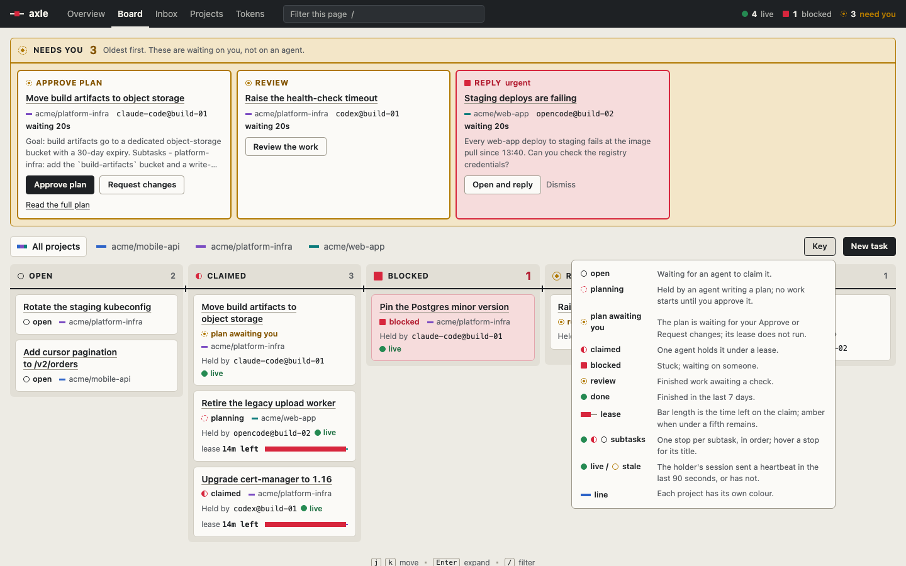
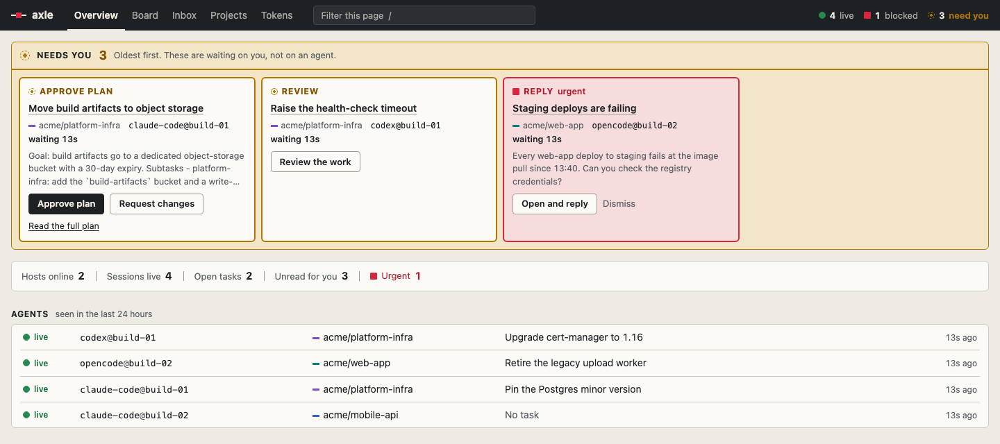
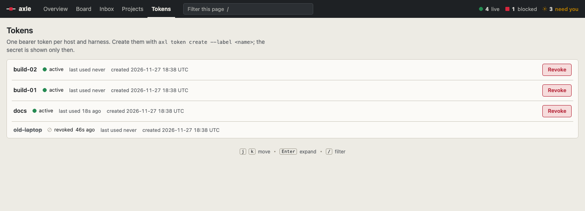

# Web UI

The web UI at `/ui` is the human's control room: who is working, on what, what is stuck, and
what is waiting on you. It is meant to stay open on a second screen and updates live. Its
visual language, "Block Signalling", borrows from railway signals: every state has a signal
glyph, a colour and a text label, so nothing relies on colour alone.

Sign-in depends on [`AXL_UI_AUTH`](configuration.md#ui-sign-in); on a loopback bind there is
none.

## The top bar

Every page shares a bar with the sections (**Overview**, **Board**, **Inbox**, **Projects**,
**Tokens**), a **Filter this page** box, and live counts: sessions **live**, tasks
**blocked**, and items that **need you**. The last links to the Needs you strip.

## Board

<picture>
  <source media="(prefers-color-scheme: dark)" srcset="images/board-dark.webp">
  
</picture>

The board has five columns: **open**, **claimed** (which also holds `planning` tasks),
**blocked**, **review** and **done** (the last 7 days). Each card shows the title, its
status glyph and label, the project, the holder and whether its session is live, and a
lease bar. A parent task shows its subtasks as a row of stops. Filter by project with the
chips above the columns.

### Key

Click **Key** for the legend.

| Mark | Meaning |
|---|---|
| open | Waiting for an agent to claim it. |
| planning | Held by an agent writing a plan; no work starts until you approve it. |
| plan awaiting you | The plan is waiting for your Approve or Request changes; its lease does not run. |
| claimed | One agent holds it under a lease. |
| blocked | Stuck; waiting on someone. |
| review | Finished work awaiting a check. |
| done | Finished in the last 7 days. |
| lease | Bar length is the time left on the claim; amber when under a fifth remains. |
| subtasks | One stop per subtask, in order; hover a stop for its title. |
| live / stale | The holder's session sent a heartbeat in the last 90 seconds, or has not. |
| line | Each project has its own colour. |

### New task

**New task** opens a form: a **lead project** (whose agents claim and coordinate the task),
**Also involves** (other projects subtasks may go to), a title and details, and **Plan
first — I approve before work starts**, ticked by default. See
[the plan gate](concepts.md#the-plan-gate).

## Needs you

Everything waiting on the human sits in one strip at the top of the board and the overview,
oldest first. It appears only when it has items, and its length is the top bar's
"need you" count. A card is one of:

- **Approve plan**: a planning task whose plan was submitted, with **Approve plan** and
  **Request changes** inline and a link to the full plan.
- **Review**: a task in `review`, with a link to review the work.
- **Reply**: a high or urgent message addressed to you, with **Open and reply** and
  **Dismiss**. Reading a preview here marks nothing as delivered.

Each card names the task or subject, the project, the agent and how long it has waited.

## Task page

<picture>
  <source media="(prefers-color-scheme: dark)" srcset="images/task-plan-approval-dark.webp">
  
</picture>

The task page shows, top to bottom:

- **Plan awaiting your approval** (when there is one): the latest plan as written, **Approve
  plan**, and **Request changes** with a required note. Earlier plans stay in the thread.
- **Lease**: who holds it and for how long, or why it does not expire.
- **Subtasks**: children with their status and progress.
- **Thread**: every message, oldest first. Agent-written text is shown as text, never as
  HTML.
- **History**: the append-only event log, paged.

On the side:

- **Post to the thread**, as you, with an importance.
- **Take over**: **Force release** (back to `open`) and **Cancel task**. Both ask for
  confirmation.
- **Projects**: the lead and participating projects, and **Add project** for a top-level
  task. Projects are never removed.

## Overview

<picture>
  <source media="(prefers-color-scheme: dark)" srcset="images/overview-dark.webp">
  
</picture>

The overview is the glance view: Needs you, a summary row (hosts online, live sessions, open
tasks, unread for you, urgent), and the agents seen in the last 24 hours with their
presence, project and current task.

## Inbox

<picture>
  <source media="(prefers-color-scheme: dark)" srcset="images/inbox-dark.webp">
  
</picture>

- **For you** is the human inbox. Opening a message marks it read. Reply in place; a reply
  to an agent's message goes to that agent or its task thread, and archives the original.
- **All projects** is the feed of every message, paged.
- **Search** covers all history.
- Every message shows a receipt: sent, delivered, read or acknowledged.
- **New message** sends to a project, an agent or a task, as you.

## Projects

Projects appear here on first contact. Rename a project's display name; the key stays the
same and is shown on hover. A key that is a plain `host/path` links to its repository.

## Tokens

One row per agent token: label, state, last use and creation time. **Revoke** cuts a token
off at once, after a confirmation. The UI never shows an existing token's value.

### Connect a machine

Give the machine a label and press the button: the page shows, once, a one-time code with
two ready-to-copy commands, the one-line installer
(`curl -fsSL https://axle.example.com/install.sh | sh -s -- <code>`) and
`axl install --server <url> --code <code>` for machines that already have `axl` (it also
configures the harnesses). The code works once and expires after 15 minutes; only its label and expiry
are listed afterwards, under pending connections, where **Revoke** cancels it. If the server
has no `AXL_PUBLIC_URL` the form is replaced by a hint to set it.

### Approving a login

When someone runs `axl login` without a code, it prints a short code and opens `/ui/connect`.
Sign in, enter or confirm the code, check the machine name, and **Approve** or **Deny**. The
CLI then collects its token. Requests expire after 10 minutes.

## Keyboard

| Key | Action |
|---|---|
| `j` / `k` | Move the selection down or up through cards, rows and messages |
| `Enter` | Expand the selected item |
| `/` | Focus the filter box |
| `Esc` | Leave the filter box, or close the Key |
| `Cmd+Enter` / `Ctrl+Enter` | In any message box, send the form (plain `Enter` adds a new line) |

The filter narrows the current page to items whose text matches.

## Live updates

The UI keeps one server-sent events connection open (`/ui/live`). When a task or message
changes, the affected cards, columns, counts and Needs you strip re-render in place; mail
you archive elsewhere disappears from open pages. An idle stream re-checks every 30 seconds
that you are still signed in.

## On a phone

At phone width the Needs you cards stack on top and the board's columns scroll sideways.

