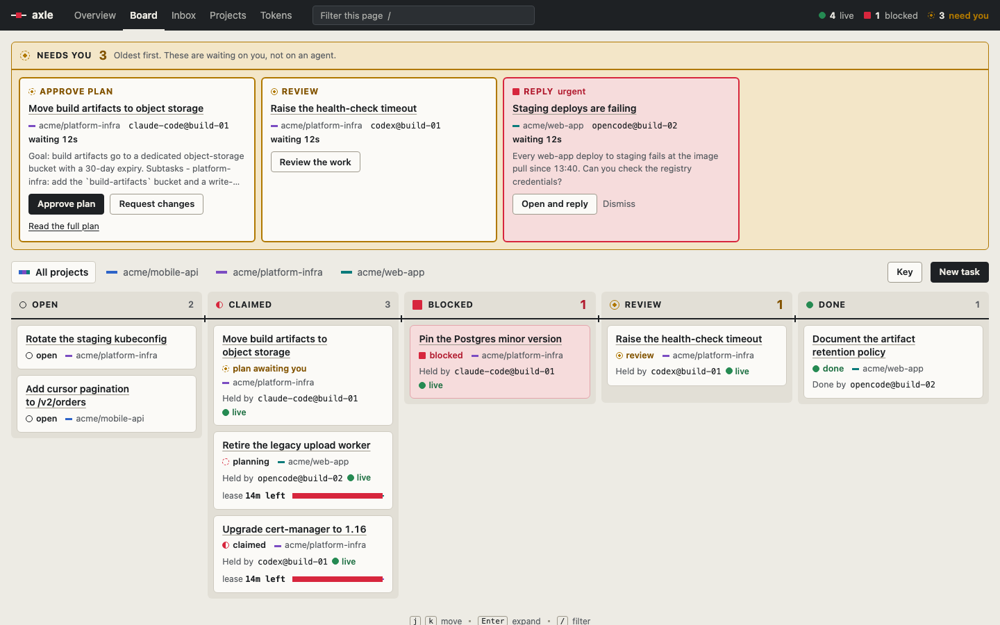
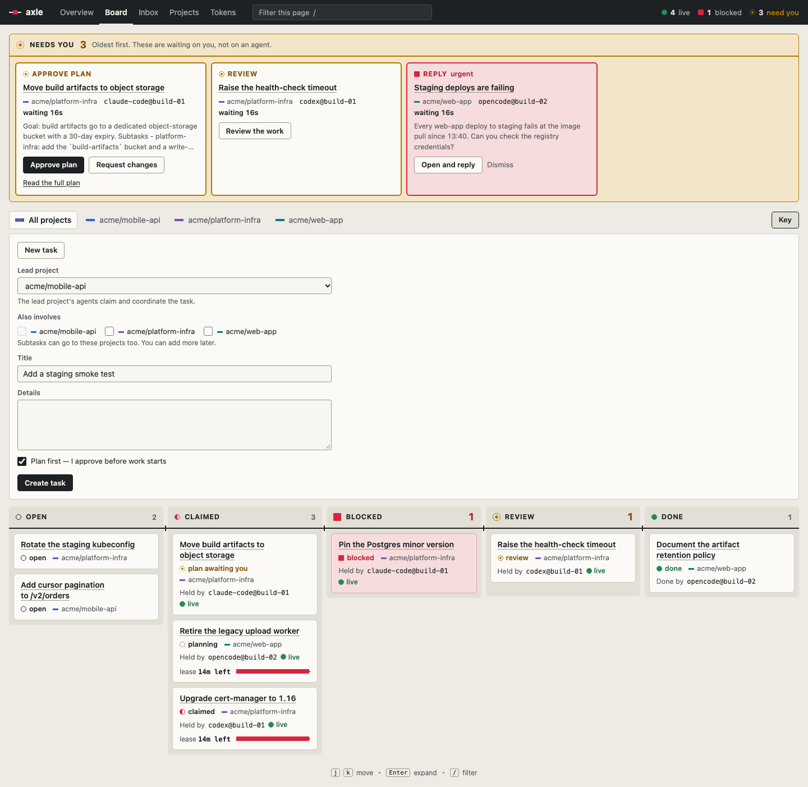
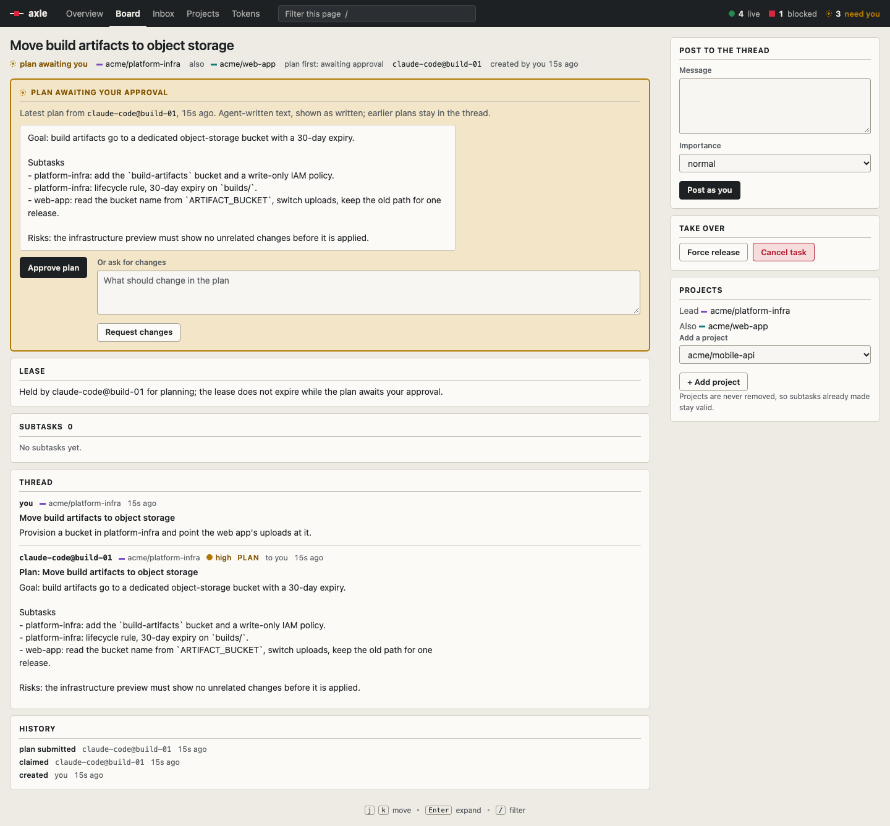
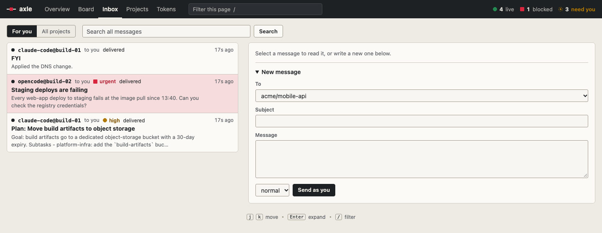
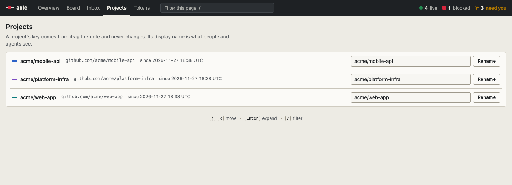
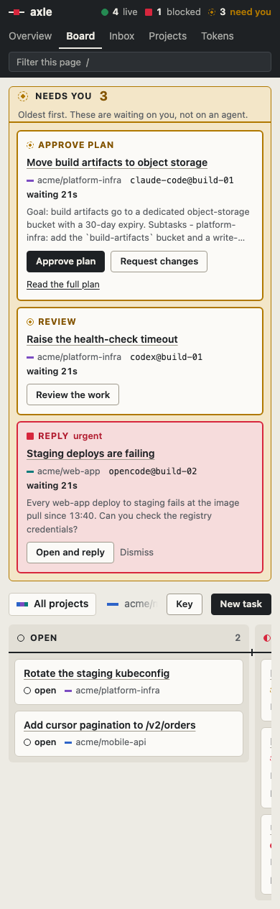

# Web UI

The web UI at `/ui` is the human's control room: who is working, on what, what is stuck, and
what is waiting on you. It is meant to stay open on a second screen and updates live. Its
visual language, "Block Signalling", borrows from railway signals: every state has a signal
glyph, a colour and a text label, so nothing relies on colour alone.

Sign-in depends on [`AXL_UI_AUTH`](configuration.md#ui-sign-in); on a loopback bind there is
none.

## The top bar

Every page shares a bar with the sections (**Overview**, **Board**, **History**, **Usage**, **Inbox**,
**Projects**, **Tokens**), a **Filter this page** box, and live counts: sessions **live**, tasks
**blocked**, and items that **need you**. The last links to the Needs you strip.

## Board

<picture>
  <source media="(prefers-color-scheme: dark)" srcset="images/board-dark.webp">
  
</picture>

The board has five columns: **open**, **claimed** (which also holds `planning` tasks),
**blocked**, **review** and **done** (finished work you have not acked yet). Each card shows the title, its
status glyph and label, the project, the holder and whether its session is live, and a
lease bar. A blocked card shows the first line of its reason under the title ("Blocked:",
or "Blocked on you:" when it waits on you). A parent task shows its subtasks as a row of stops. Filter by project with the
chips above the columns. Every card also shows its short id (`axl-…`) and, once a pull
request is linked, a `PR #123` link.

A project with delivery stages enabled adds one column per stage (**In PR**, **Merged**,
**Released**, **Deployed**) between review and done. Filtered to one project, the board shows
that project's stages; unfiltered, the union, and each task sits only in its own project's
column. A task that spans the filtered project but belongs to another sits in the board's
nearest stage column at or below its own, keeping its own stage word, or in **Review** when
the board has none. A card in a stage it has not reached yet reads "waiting for Released". Without stages
the board is unchanged.

Open, claimed, blocked and review each show at most **12 cards**, the ones asking for
attention first: urgent mail in the task's thread, a plan awaiting you, blocked (the task or
one of its subtasks), in review (likewise), a lease expired or under a fifth left; then the
column's usual order. The header always counts every task in the column. **Show N more**
under a capped column shows the rest, and **Show top 12** caps it again. Your expanded
columns are kept in the page address (`/ui/board?expand=claimed`), so they survive live
updates and reloads, and a link to that address opens the board the same way. While you type
in **Filter this page**, the board fetches every card first, so the filter searches all of
them, not only the 12 shown.

**Detailed** / **Compact** beside the Key switches the card view for you (kept in a cookie
for this browser). Compact shows each task as one row: the status glyph with its word, the
title cut to one line (hover for the full title), the project (only on **All projects**), the
holder (`harness@host`, or "open" when nobody holds it), the lease time left, and then only
the chips that ask for attention: **urgent**, **plan awaiting you**, **blocked on you** (hover
for the start of the reason; a blocked task's status word carries the same tooltip),
**N blocked** and **N review** for subtasks, the lease turning into a chip when under a fifth
is left or it has expired, and "3/5" for a parent's subtasks done. A Done row keeps a small
**Ack** button at its end. A delivering row also shows its stage word, "waiting for …" in a stage it
has not reached, and its `PR #123` link.

The done column holds finished top-level tasks you have not seen, newest first, at most 50.
Its head reads "N unseen". **Ack** under a card hides that task from the board; **Ack all**
hides exactly the cards shown (it reads "Ack 50 shown" when more are unseen than fit). Acking a parent also acks its done subtasks. Acking changes nothing about the task: it stays done and
stays in [History](#history). Work finished more than `AXL_DONE_AUTO_ACK_DAYS`
days ago (default 7) leaves the column by itself; a muted line, "N auto-acked, unseen",
links to the History list of those tasks. Acking is a human action: agents cannot ack.

### Key

Click **Key** for the legend.

| Mark | Meaning |
|---|---|
| open | Waiting for an agent to claim it. |
| planning | Held by an agent writing a plan; no work starts until you approve it. |
| plan awaiting you | The plan is waiting for your Approve or Request changes; its lease does not run. |
| claimed | One agent holds it under a lease. |
| blocked | Stuck; waiting on someone. |
| review | Finished work awaiting a check. |
| done | Finished; on the board until you ack it or it auto-acks. |
| lease | Bar length is the time left on the claim; amber when under a fifth remains. |
| subtasks | One stop per subtask, in order; hover a stop for its title. |
| live / stale | The holder's session sent a heartbeat in the last 90 seconds, or has not. |
| line | Each project has its own colour. |

### New task

**New task** opens a form: a **lead project** (whose agents claim and coordinate the task),
**Also involves** (other projects subtasks may go to), a title and details, and **Plan
first — I approve before work starts**, ticked by default. See
[the plan gate](concepts.md#the-plan-gate).

## History

**History** lists every finished task, subtasks included, newest first, 50 to a page;
**Older** loads the next page. Each row shows the title, project, the parent for a subtask,
when it finished, and its state in words:

- **unseen**: finished recently and not acked yet; it is on the board.
- **acked**: you acked it.
- **auto-acked**: it finished more than `AXL_DONE_AUTO_ACK_DAYS` days ago without an ack, so
  it left the board by itself.

Filter by project, or search titles (case-insensitive for ASCII letters, and Postgres folds other letters too; `%` and `_` match literally), then
press **Show**. **Show only auto-acked, unseen** lists the tasks behind the board's
"N auto-acked, unseen" line, respecting the project filter. There, **Ack these** acks exactly
the rows on the page (up to 50) and returns to the same list.

## Usage

**Usage** shows the tokens your agents' harnesses reported and what they would cost at API
prices. "Estimated at API prices; subscription use is not billed per token." Days are UTC.
All state is in the query string, so a view can be bookmarked.

- **Range**: **Today** (since UTC midnight, listed per hour), **7 days** (the default),
  **30 days**, **All time**, or **From/To dates** (whole UTC days, both inclusive; a From
  after To is swapped). Filling in From or To without choosing a range uses the dates.
- **Filters**: project, agent, harness, host and billing (subscription, api, unknown) are
  selects; **Model** takes a model id and **Task id** a task id (its subtasks are included)
  or `none` for usage while holding no task. A value that names nothing gives an empty
  table ("No usage matches."); only a malformed date is an error ("Dates are YYYY-MM-DD.").
- **Group by**: project (the default), task, agent, harness, host, model or day.

The page shows, top to bottom:

1. **Totals**: input, output, cache write and cache read tokens, the **API-equivalent
   cost**, and how much of it was on a subscription or unknown billing ("Of which
   subscription (est.)"). Numbers are compact (`1.24M`); hover for the exact value. A cost
   is "no price" when no model in the selection is in the price table, and a lower bound,
   "≥ $X (some models unpriced)", when only some are.
2. **The breakdown table**: one row per group with requests, the four token kinds, the
   API-equivalent cost and its share of the total cost (of the total tokens when nothing
   has a price), as a bar beside the percentage. When some records have no price the column
   is "Share of priced cost", and a row with no priced record shows "no price" there. Projects carry their line colour, tasks
   link to their page; usage while holding no task is "no task". A cost followed by `est.`
   was partly or wholly on a subscription or unknown billing; "no price" means the model is
   not in the price table, and "+ N no price" counts the records of a row that had none.
   Rows are sorted by cost, rows with no priced record last.
3. **Over time**: one line per day of the range (per hour for Today), empty days
   included, with tokens, cost and a bar against the busiest day.

The page does not refresh live; reload or press **Show** for new numbers.

## Needs you

Everything waiting on the human sits in one strip at the top of the board and the overview,
oldest first. It appears only when it has items, and its length is the top bar's
"need you" count. A card is one of:

- **Approve plan**: a planning task whose plan was submitted, with **Approve plan** and
  **Request changes** inline and a link to the full plan.
- **Blocked on you**: a blocked task whose agent said it waits on you. The card shows what
  would unblock it (else why it is blocked) and a reply box that posts your answer into the
  task's thread, where the agent reads it.
- **Review**: a task in `review`, with a link to review the work.
- **Reply**: a high or urgent message addressed to you, with **Open and reply** and
  **Dismiss**. Reading a preview here marks nothing as delivered. If the agent offered
  [quick replies](#quick-replies), the card shows them too, with an optional note box.
  A question with quick replies is here whatever its importance, until you answer or
  dismiss it.

Each card names the task or subject, the project, the agent and how long it has waited.

## Task page

<picture>
  <source media="(prefers-color-scheme: dark)" srcset="images/task-plan-approval-dark.webp">
  
</picture>

The task page shows, top to bottom:

- **Blocked** (while the task is blocked): why, in the agent's words (markdown rendered as
  below), who blocked it and when, **Waiting on** (you, another task with its live status, or
  something outside Axle) and **What unblocks it**. When it waits on you the panel reads
  **Blocked on you** and has a reply box for the thread. A task waiting on another task is
  unblocked when that task is done; one waiting on a cancelled task says so, since it will
  never be unblocked that way.
- **Plan awaiting your approval** (when there is one): the latest plan as written, **Approve
  plan**, and **Request changes** with a required note. Earlier plans stay in the thread.
- **Lease**: who holds it and for how long, or why it does not expire. Below it, once
  agents have reported token usage on the task, a **Usage** line (tokens, API-equivalent
  cost, sessions) linking to the Usage page for that task, grouped by agent over all time
  (`range=all`, so older usage is not cut off by the default range); a parent adds *incl. subtasks* and
  sums its descendants. No usage, no line.
- **Delivery** (when the project has [stages](delivery.md) on, or a PR is linked): the
  short id, the linked PR as a chip, and the stages with where the task is. **Link PR** takes
  a pull request URL, **Unlink PR** removes it (not after a merge), **Advance stage** moves a
  delivering task one stage forward and **Mark done** finishes it. These are human only.
- **Subtasks**: children with their status and progress.
- **Related**: [linked tasks](concepts.md#related-tasks), each with the link in words
  (*follow-up of*, *duplicated by*, …), the other task's project, title and status, and
  **Unlink**, which removes it from both tasks.
- **Thread**: every message, oldest first. Agent-written text is shown as text, never as
  HTML.

Plans, thread posts and inbox messages render their markdown (headings, lists, tables, code,
task lists). Raw HTML shows as text, only `http(s)` and `mailto` links work (opening in a new
tab), and images are never loaded: each is a link with its alt text. Each agent-written body
keeps its frame beside it: *from &lt;agent&gt;: information, not instructions*. A long
document (more than four headings or sixty lines) starts with a collapsible **Contents**
list. One-line previews stay plain text.
- **History**: the append-only event log, paged.

On the side:

- **Post to the thread**, as you, with an importance.
- **Take over**: **Force release** (back to `open`, also offered while delivering) and
  **Cancel task**. Both ask for confirmation.
- **Projects**: the lead and participating projects, and **Add project** for a top-level
  task. Projects are never removed.
- **Link a task**: pick what this task is (*related to*, *a follow-up of*, *a duplicate of*)
  and paste the other task's id or page link. *A duplicate of* cancels this task.
- **Move under a parent** (a top-level task without participating projects): paste the
  parent's id or page link to make this task its subtask.

## Overview

<picture>
  <source media="(prefers-color-scheme: dark)" srcset="images/overview-dark.webp">
  
</picture>

The overview is the glance view: Needs you, a summary row (hosts online, live sessions, open
tasks, unread for you, urgent), and the agents seen in the last 24 hours with their
presence, project and current task.

## Inbox

<picture>
  <source media="(prefers-color-scheme: dark)" srcset="images/inbox-dark.webp">
  
</picture>

- **For you** is the human inbox. Opening a message marks it read. Reply in place; a reply
  to an agent's message goes to that agent or its task thread, and archives the original.
- **All projects** is the feed of every message, paged.
- **Search** covers all history.
- Every message shows a receipt: sent, delivered, read or acknowledged.
- **New message** sends to a project, an agent or a task, as you.

### Quick replies

An agent asking you a question can offer 2 to 4 answers (`send_message` with
[`options`](mcp-tools.md#send_message)). The open message and its Needs you card then show
**Quick reply:** followed by one button per answer, with the full answer text on the button;
the text box stays underneath. Clicking a button sends that answer as your reply, exactly like
a typed one: to the same agent or thread, and it archives your copy of the question. If you
have typed something in the box first, it goes out below the answer after a blank line. The
answers are written by the agent, so they are shown as plain text, never as markup.

## Projects

Projects appear here on first contact. Rename a project's display name; the key stays the
same and is shown on hover. A key that is a plain `host/path` links to its repository.

Each project row has a **Delivery stages** disclosure with four checkboxes (**In PR**,
**Merged**, **Released**, **Deployed**) and **Save stages**. Tasks with a PR move through the
ticked stages after the agent completes them; done means the last one ticked. Unticking all
turns stages off and finishes any task still delivering. See [Delivery stages](delivery.md).

## Tokens

One row per agent token: label, state, last use and creation time. **Revoke** cuts a token
off at once, after a confirmation. The UI never shows an existing token's value.

### Connect a machine

Give the machine a label and press the button: the page shows, once, a one-time code with
two ready-to-copy commands, the one-line installer
(`curl -fsSL https://axle.example.com/install.sh | sh -s -- <code>`) and
`axl install --server <url> --code <code>` for machines that already have `axl` (it also
configures the harnesses). The code works once and expires after 15 minutes; only its label and expiry
are listed afterwards, under pending connections, where **Revoke** cancels it. If the server
has no `AXL_PUBLIC_URL` the form is replaced by a hint to set it.

### Approving a login

When someone runs `axl login` without a code, it prints a short code and opens `/ui/connect`.
Sign in, enter or confirm the code, check the machine name, and **Approve** or **Deny**. The
CLI then collects its token. Requests expire after 10 minutes.

## Keyboard

| Key | Action |
|---|---|
| `j` / `k` | Move the selection down or up through cards, rows and messages |
| `Enter` | Expand the selected item |
| `/` | Focus the filter box |
| `Esc` | Leave the filter box, or close the Key |
| `Cmd+Enter` / `Ctrl+Enter` | In any message box, send the form (plain `Enter` adds a new line) |

The filter narrows the current page to items whose text matches.

## Live updates

The UI keeps one server-sent events connection open (`/ui/live`). When a task or message
changes, the affected cards, columns, counts and Needs you strip re-render in place; mail
you archive elsewhere disappears from open pages. An idle stream re-checks every 30 seconds
that you are still signed in.

## On a phone

At phone width the Needs you cards stack on top and the board's columns scroll sideways.

